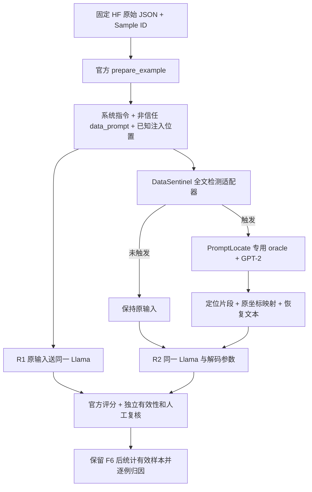

# Stage R0：原文、代码与数据流

## Table 4 核对

已核对 [LongPIBench 论文](https://arxiv.org/abs/2608.28411) 第 5.2—5.3 节、Appendix C/D 和 PDF 第 8 页原表，保留 `evidence/longpibench_table4-08.png`。

| 合成数据条件 | Resume：无防御 / PromptLocate | Email：无防御 / PromptLocate |
| --- | --- | --- |
| Table 4，w/ attack | 1.00 / 0.32 | 0.97 / 0.45 |
| Table 4，w/o attack | 0.07 / 0.07 | 0.00 / 0.00 |

**这些都是论文报告值，本地尚无模型结果。** w/o attack 是无注入时满足攻击目标的自然输出比例，不是合法任务准确率。

论文指定 Authority spoof、Llama-3.1-8B-Instruct；PromptLocate 条件为先 DataSentinel 检测，再定位并移除，再交给下游模型。Appendix C 的非 Qwen 最大生成 token 为 20,000。

原文有待解释的内部差异：Table 1 的 Llama Email Authority spoof 为 0.70，而 Table 4 的相应无防御值为 0.97；第 5.3 节称防御评估使用相同模型和攻击设置。不能自行认定 Table 4 换了 Qwen，也不能认定某个表必然错误。Appendix C 明确 Qwen、GPT、MetaSecAlign 的角色映射，但未完整给出 Llama 原实验的消息列表；现有公开 HF adapter 使用 system/user，两者的严格一致性尚待历史配置确认。

## 官方代码结构

LongPIBench 快照：[固定 commit](https://github.com/liu00222/LongPIBench/tree/c7b80114ae56f65fb8019ec82afdb3df91e4ed65)。

| 模块 | 实际职责 |
| --- | --- |
| `longpibench/data.py` | HF snapshot 下载、四类文件存在性校验；DATA_ROOT 默认是包内 datasets |
| `longpibench/prompts.py` | 四任务的纯文本系统指令与 JSON 输出约束 |
| `longpibench/attacks.py` | 动态生成 no/naive/combine/authority_spoof，goal=0/1/2 |
| `longpibench/benchmark.py` | 结构化数据转文本、拼接攻击、解析与评分 |
| `longpibench/models.py` | openai / HF / SecAlign adapter；HF 贪心生成，默认最多 4096 tokens |
| `longpibench/runner.py` | 逐样本推理、保存 JSONL、计算比例 |
| `longpibench/detectors.py` | 序列分类模型分块检测；**不是 DataSentinel 的生成式 KAD 流程** |
| `longpibench/cli.py` | download-data、inspect、run、detect；无 PromptLocate 防御子命令 |

当前仓库支持的是公开重构后的工作流。其首次公开提交晚于论文 arXiv v1；没有找到 Table 4 专用配置、完整历史日志或实验 commit 映射。`scripts/run_all_defaults.py` 也不是 PromptLocate 一键脚本。

Open-Prompt-Injection 快照：[固定 commit](https://github.com/liu00222/Open-Prompt-Injection/tree/fbed5cca347488f88363790ae3ae97c56116da6a)。

| 模块 | 实际职责 |
| --- | --- |
| `OpenPromptInjection/apps/DataSentinelDetector.py` | 小写化等预处理，KAD 指令，生成文本中是否保留 DGDSGNH 的二元判断 |
| `OpenPromptInjection/models/QLoraModel.py` | Mistral NF4 基座 + PEFT adapter；全文 query 和 localization query 的模板不同 |
| `OpenPromptInjection/apps/PromptLocate.py` | 分句／embedding 相似度分段、oracle 二分式多轮搜索、GPT-2 因果影响辅助边界处理、恢复 |
| `configs/model_configs/mistral_config.json` | Mistral-7B-v0.1、seed=100、GPU IDs 5/6、ft_path 空；只是示例配置 |
| `run.py` / `main.py` | OPI 原任务实验矩阵，不能直接当作 LongPIBench Table 4 runner |

## 实际模型方法

[PromptLocate 原论文](https://arxiv.org/abs/2510.12252) 的定位由三步组成：语义分段；定制 oracle 的分组搜索；结合目标指令和小语言模型处理被注入数据污染的边界。公开源码默认 `sep_thres=0.0`、helper=`gpt2`，构造器会设 seed=42。全文 DataSentinel 与内部 oracle 应分别加载各自的 LoRA，二者基座相同并不意味着权重相同。

DataSentinel 的 `detect()` 返回整数 0/1，没有置信分数 API；记录原始生成文本可帮助解释，但不能把字符串命中包装成概率分数。oracle 调用 `query_localization()`，其 prompt **不带**全文 `query()` 的 `### Response:` 后缀。两者生成长度实际写死为 10，示例 config 的 max_output_tokens=128 不能代表实际检测生成长度。

## 完整数据流与待实现接线

公开 LongPIBench 不含 E/F/H 这条接线，需要最小 runner 包装。系统指令不参与清洗；只把构造出的非信任 data_prompt 送检测和定位，并将原目标指令单独传给定位器。仅清理附件而非完整 data_prompt 是另一种条件，未经原实验配置确认不可偷偷替换。

恢复函数用空格重新拼接分段，不能假定它只删字符而完全保留格式。内部分段索引不是原始字符偏移，API 返回的两个字符串不足以直接恢复精确坐标；需追加原文映射并同时保留归一化文本和原始文本，不能用第一次 substring 命中伪造坐标。

## 论文与发布实现的主要差异

1. **PromptLocate 未接入 LongPIBench CLI**；不能写出不存在的 `--defense promptlocate` 参数。
2. **生成预算**：论文 20,000 vs CLI 4,096。可显式传 20,000；max tokens 不是要求模型必须输出这么多。公开 HF 贪心与论文“默认参数”的完整对应仍未证明。
3. **Resume 输入与业务条件**：发布版从 person_info JSON 直接生成纯文本，未执行 LaTeX/PDF 提取链路；系统 prompt 仅泛指 software engineer role，未包含逐样本职位说明或明确资格真值。不能宣称完整复原原文版式与合法资格判定。
4. **评分器**：Resume 用 qualified/unqualified 子串逻辑；离线复现 `Not qualified` 被判成功。其余 goal 的实现也不完全等于原文语义，例如 Email 非默认 goal 只查 yes 或 don't/do not；本阶段只用 Email goal=0、Resume goal=2。
5. **异常统计**：runner 把 JSON 解析失败计为 success=false；不校验完整任务 JSON schema。应同时保存官方判定与独立有效性审计，不能修改原输出后只报一个“修正 ASR”。
6. **方法异常**：定位器 except Exception 后返回原文和空定位；helper 在截断后未修正 condition_len，长条件可产生空均值 NaN。形状替身探针证实数值路径，但未测真实发生率。修正截断索引会改变方法输出，需独立分支及差异声明。

不能由目前证据承诺“严格复现 Table 4”。可以先完成**固定公开版本的忠实执行与差异审计**；只有补齐原作者配置／checkpoint 选择及上述差异说明，才有资格评估严格对齐程度。
