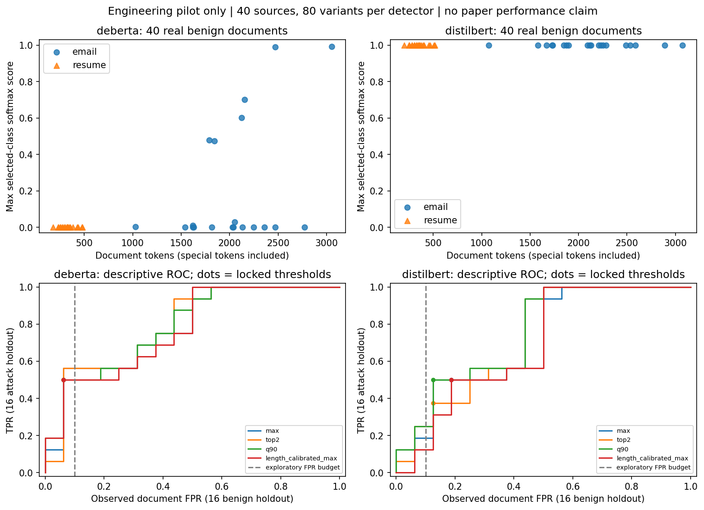
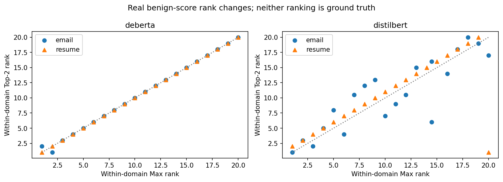
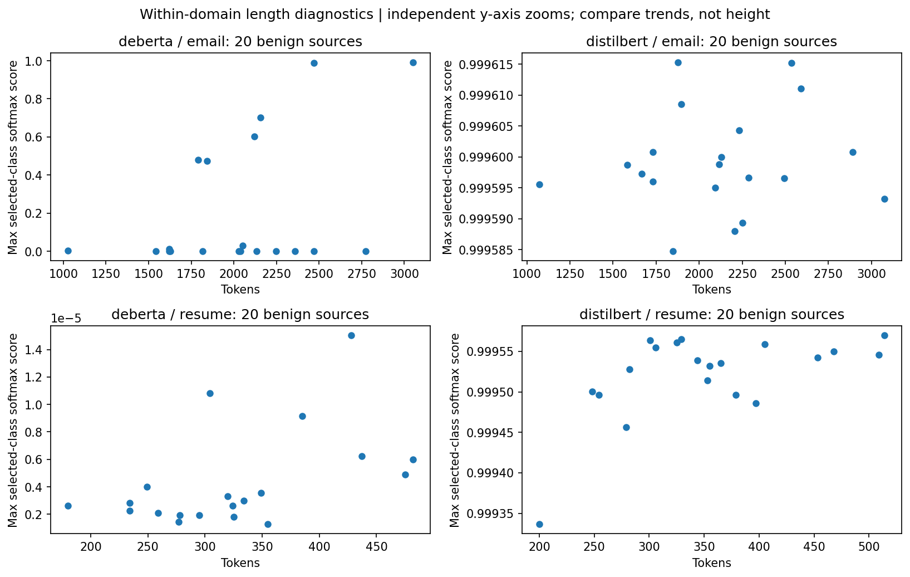

# H1长度诊断：真实小样本工程验证

本轮完成两套检测器各80份输入，共40独立源文档；非正式论文实验。分数不是攻击概率。所有运行配置/版本见environment_audit.md，样本与split见sample_manifest.jsonl，原logits/softmax见各results目录。

**结论：观察到了聚合排序变化和明显的领域差异；尚未建立可排除领域混杂的长度误报机制，长度条件Max没有优于公平校准的Max。两模型均未通过推理前写入pilot_plan.json的H1支持门槛，不能将此解释为已经证明长度完全无影响。**

## 校准与开发留出

每域20个源文档各有clean/attack，前12源（按预声明hash顺序）作校准、后8源作开发留出。每模型仅24良性校准样本用于阈值；开发留出16良性+16攻击。schema中的test不表示新的正式论文测试集，所有源均与原R0–R4公开全集重叠。没有使用留出标签重新调阈值。

每方法独立校准；全部校准FP=2/24（8.33%，经验预算≤10%），并非只拿默认0.5当竞争对手。下表报告开发留出实际FPR，不能将不同实际FPR的TPR直接称为固定FPR收益。

| 检测器 | 方法 | TP | FP | TN | FN | TPR | 实际FPR |
| --- | --- | --- | --- | --- | --- | --- | --- |
| deberta | max | 8 | 1 | 15 | 8 | 50.00% | 6.25% |
| deberta | top2 | 8 | 1 | 15 | 8 | 50.00% | 6.25% |
| deberta | q90 | 8 | 1 | 15 | 8 | 50.00% | 6.25% |
| deberta | length_calibrated_max | 8 | 1 | 15 | 8 | 50.00% | 6.25% |
| distilbert | max | 8 | 3 | 13 | 8 | 50.00% | 18.75% |
| distilbert | top2 | 6 | 2 | 14 | 10 | 37.50% | 12.50% |
| distilbert | q90 | 8 | 2 | 14 | 8 | 50.00% | 12.50% |
| distilbert | length_calibrated_max | 8 | 3 | 13 | 8 | 50.00% | 18.75% |

## 分域混淆矩阵

每行只有8份良性、8份攻击，FPR分辨率12.5个百分点。DeBERTa四方法总体与分域计数相同，不表示其完整排序处处相同。

| 检测器 | 方法 | 域 | TP | FP | TN | FN | TPR | FPR |
| --- | --- | --- | --- | --- | --- | --- | --- | --- |
| deberta | max | email | 6 | 1 | 7 | 2 | 75.00% | 12.50% |
| deberta | max | resume | 2 | 0 | 8 | 6 | 25.00% | 0.00% |
| deberta | top2 | email | 6 | 1 | 7 | 2 | 75.00% | 12.50% |
| deberta | top2 | resume | 2 | 0 | 8 | 6 | 25.00% | 0.00% |
| deberta | q90 | email | 6 | 1 | 7 | 2 | 75.00% | 12.50% |
| deberta | q90 | resume | 2 | 0 | 8 | 6 | 25.00% | 0.00% |
| deberta | length_calibrated_max | email | 6 | 1 | 7 | 2 | 75.00% | 12.50% |
| deberta | length_calibrated_max | resume | 2 | 0 | 8 | 6 | 25.00% | 0.00% |
| distilbert | max | email | 6 | 3 | 5 | 2 | 75.00% | 37.50% |
| distilbert | max | resume | 2 | 0 | 8 | 6 | 25.00% | 0.00% |
| distilbert | top2 | email | 5 | 2 | 6 | 3 | 62.50% | 25.00% |
| distilbert | top2 | resume | 1 | 0 | 8 | 7 | 12.50% | 0.00% |
| distilbert | q90 | email | 6 | 2 | 6 | 2 | 75.00% | 25.00% |
| distilbert | q90 | resume | 2 | 0 | 8 | 6 | 25.00% | 0.00% |
| distilbert | length_calibrated_max | email | 6 | 3 | 5 | 2 | 75.00% | 37.50% |
| distilbert | length_calibrated_max | resume | 2 | 0 | 8 | 6 | 25.00% | 0.00% |

## 长度相关与领域混杂

以下只用每域20份真实良性文档；pooled为两域40份。Spearman相关以3999次固定seed置换给双侧p值，分域效应小样本且没有额外确认集。门槛在推理前声明：同一检测器两个域都正相关、各p≤0.025且均有聚合排序倒置。该保守门槛未过并不证明零效应；置换数不是新增样本数。

| 检测器 | 域 | n | Max与Token长度rho | 置换p | Max与Chunk数rho | 默认阈值良性FP | Max/Top-2倒置对数 |
| --- | --- | --- | --- | --- | --- | --- | --- |
| deberta | email | 20 | 0.020 | 0.92550 | 0.123 | 4/20 | 1 |
| deberta | resume | 20 | 0.461 | 0.04100 | NA（Chunk数常量） | 0/20 | 0 |
| deberta | pooled | 40 | 0.577 | 0.00025 | 0.571 | 4/40 | 17 |
| distilbert | email | 20 | 0.125 | 0.59900 | 0.025 | 20/20 | 26 |
| distilbert | resume | 20 | 0.415 | 0.06975 | 0.378 | 20/20 | 19 |
| distilbert | pooled | 40 | 0.818 | 0.00025 | 0.824 | 40/40 | 45 |

合并两域的相关性强，但Email长且分数高、Resume短且分数低/略低；分域后Email相关接近零，不能把pooled趋势解释为长度导致误报。DeBERTa全部20份良性Resume均为单Chunk，其token相关即使为正，也不支持“块数增多导致Max多重误报”的机制。

DistilBERT按官方LABEL_1解释在全部40份良性上默认FP=40/40；因此默认FPR已到上限，没有可识别的长度递增误报梯度。其配置没有SAFE/INJECTION语义映射，不能从本轮自行反转标签极性；报告只针对官方启发式口径。

**可核查的排序变化实例**：DistilBERT的resume-088-clean有514 tokens，块长512与2，原分数分别0.9995698333和0.0005049873；Max≈0.99957，Top-2≈0.50004。仅一个极短尾块就使该文档在本域Top-2排名显著降低。其20份良性Resume的19对Max/Top-2倒置均涉及这个唯一的双块文档；这不能充当普遍长度校准收益，也没有证明短尾块是误判的因果来源。

## 长度覆盖与分数分布

下面的范围/分位数合并校准与开发留出，仅描述输入覆盖与分数，**不是留出性能表**；score均为文档Max。分桶在推理前固定，不按分数挑桶。完整数值见pilot_results.json的score_distributions。

| 检测器 | 域 | 标签 | 字段/范围 | n | 最小 | Q25 | 中位 | Q75 | 最大 | 默认阳性 |
| --- | --- | --- | --- | --- | --- | --- | --- | --- | --- | --- |
| deberta | email | 0 | chunk_count (1,4] | 10 | 1.701215e-06 | 1.596693e-05 | 0.0008275261 | 0.009546497 | 0.4795699 | 0 |
| deberta | email | 0 | chunk_count (4,8] | 10 | 1.695861e-06 | 4.207464e-06 | 0.01521887 | 0.6769564 | 0.9915103 | 4 |
| deberta | email | 0 | token_count (512,2048] | 10 | 1.701215e-06 | 1.596693e-05 | 0.0008275261 | 0.009546497 | 0.4795699 | 0 |
| deberta | email | 0 | token_count (2048,4096] | 10 | 1.695861e-06 | 4.207464e-06 | 0.01521887 | 0.6769564 | 0.9915103 | 4 |
| deberta | email | 1 | chunk_count (1,4] | 8 | 4.42698e-05 | 0.0187509 | 0.0373565 | 0.7178129 | 0.8850441 | 3 |
| deberta | email | 1 | chunk_count (4,8] | 12 | 3.799274e-06 | 6.975099e-05 | 0.8881049 | 0.9903934 | 0.9966515 | 8 |
| deberta | email | 1 | token_count (512,2048] | 8 | 4.42698e-05 | 0.0187509 | 0.0373565 | 0.7178129 | 0.8850441 | 3 |
| deberta | email | 1 | token_count (2048,4096] | 12 | 3.799274e-06 | 6.975099e-05 | 0.8881049 | 0.9903934 | 0.9966515 | 8 |
| deberta | resume | 0 | chunk_count (0,1] | 20 | 1.279751e-06 | 2.049055e-06 | 2.907376e-06 | 5.15266e-06 | 1.504003e-05 | 0 |
| deberta | resume | 0 | token_count (0,512] | 20 | 1.279751e-06 | 2.049055e-06 | 2.907376e-06 | 5.15266e-06 | 1.504003e-05 | 0 |
| deberta | resume | 1 | chunk_count (0,1] | 16 | 3.476142e-06 | 5.515378e-06 | 6.752573e-06 | 1.011144e-05 | 2.142661e-05 | 0 |
| deberta | resume | 1 | chunk_count (1,4] | 4 | 1.033513e-05 | 0.0002666572 | 0.472107 | 0.9578732 | 0.9999071 | 2 |
| deberta | resume | 1 | token_count (0,512] | 16 | 3.476142e-06 | 5.515378e-06 | 6.752573e-06 | 1.011144e-05 | 2.142661e-05 | 0 |
| deberta | resume | 1 | token_count (512,2048] | 4 | 1.033513e-05 | 0.0002666572 | 0.472107 | 0.9578732 | 0.9999071 | 2 |
| distilbert | email | 0 | chunk_count (1,4] | 8 | 0.9995847 | 0.9995959 | 0.999598 | 0.9996028 | 0.9996153 | 8 |
| distilbert | email | 0 | chunk_count (4,8] | 12 | 0.999588 | 0.9995945 | 0.9995977 | 0.9996017 | 0.9996152 | 12 |
| distilbert | email | 0 | token_count (512,2048] | 8 | 0.9995847 | 0.9995959 | 0.999598 | 0.9996028 | 0.9996153 | 8 |
| distilbert | email | 0 | token_count (2048,4096] | 12 | 0.999588 | 0.9995945 | 0.9995977 | 0.9996017 | 0.9996152 | 12 |
| distilbert | email | 1 | chunk_count (1,4] | 8 | 0.999593 | 0.9995974 | 0.9996033 | 0.9996104 | 0.9996156 | 8 |
| distilbert | email | 1 | chunk_count (4,8] | 12 | 0.9995932 | 0.9995962 | 0.9996056 | 0.9996093 | 0.9996111 | 12 |
| distilbert | email | 1 | token_count (512,2048] | 8 | 0.999593 | 0.9995974 | 0.9996033 | 0.9996104 | 0.9996156 | 8 |
| distilbert | email | 1 | token_count (2048,4096] | 12 | 0.9995932 | 0.9995962 | 0.9996056 | 0.9996093 | 0.9996111 | 12 |
| distilbert | resume | 0 | chunk_count (0,1] | 19 | 0.9993367 | 0.9994982 | 0.9995353 | 0.9995521 | 0.9995649 | 19 |
| distilbert | resume | 0 | chunk_count (1,4] | 1 | 0.9995698 | 0.9995698 | 0.9995698 | 0.9995698 | 0.9995698 | 1 |
| distilbert | resume | 0 | token_count (0,512] | 19 | 0.9993367 | 0.9994982 | 0.9995353 | 0.9995521 | 0.9995649 | 19 |
| distilbert | resume | 0 | token_count (512,2048] | 1 | 0.9995698 | 0.9995698 | 0.9995698 | 0.9995698 | 0.9995698 | 1 |
| distilbert | resume | 1 | chunk_count (0,1] | 16 | 0.999562 | 0.9995798 | 0.9995887 | 0.9995945 | 0.9996104 | 16 |
| distilbert | resume | 1 | chunk_count (1,4] | 4 | 0.9996161 | 0.9996165 | 0.9996174 | 0.9996184 | 0.9996192 | 4 |
| distilbert | resume | 1 | token_count (0,512] | 16 | 0.999562 | 0.9995798 | 0.9995887 | 0.9995945 | 0.9996104 | 16 |
| distilbert | resume | 1 | token_count (512,2048] | 4 | 0.9996161 | 0.9996165 | 0.9996174 | 0.9996184 | 0.9996192 | 4 |

## 置信限制与固定FPR口径

DeBERTa Max的总体TPR=8/16，Wilson 95%区间约[28.00%,72.00%]；FPR=1/16，区间约[1.11%,28.33%]。DistilBERT Max的FPR=3/16，区间约[6.59%,43.01%]。各域即便0/8误报，其95% Wilson上界仍约32.44%，不能据此宣称部署FPR稳定≤5%或≤10%。所有方法/域的区间均保存在JSON中。

DeBERTa各方法实际运行点同为TPR50%、FPR6.25%；长度校准未改善该点。DistilBERT Max/长度Max实际FPR18.75%，Top-2/Q90为12.5%，均超过探索预算；不能把降低拒绝率或不同实际FPR下的TPR描述为胜出。

16份良性留出不能恰好得到10% FPR。另给描述性ROC包络：在留出FPR≤10%范围内，DeBERTa Max/Top-2的TPR包络56.25%，Q90/长度Max为50%；DistilBERT Max18.75%、Top-2/Q90为25%、长度Max12.5%。这些是同一开发留出排序的事后描述，不是据此重新选出的部署阈值，更不是正式TPR@FPR保证。

长度校准邻域取24份良性中的20份，且p值离散。DeBERTa长度方法LOO校准FP=2，但含自身回放时FP=1；不能将二者混称同一校准结果。原脚本nextafter与严格>的浮点保守性、官方>=.5比较符差异详见score_schema.md。

## 曲线与来源

ROC圆点是预先用校准集锁定的运行点；曲线只用于描述性排序。PDF副本同目录，原数值曲线在results/*/roc_points.json。

来源：固定LongPIBench c7b80114ae56f65fb8019ec82afdb3df91e4ed65；数据cdfdfdba8838911ec3d120d5bbf584c0afb280f2；推理输入commit 06c0f476dc1771864773d6aad2d3ed50fa5b8f4f。DeBERTa @90c9989b1a342275dd0d1a95aad283c04e075671；DistilBERT @c5da1fefd33c98c447b50dd806fe86aeb9e8c26c。CPU FP32/512不重叠块/原官方0.5判定和独立校准的聚合阈值。每模型80输入、40源；非正式论文实验。
