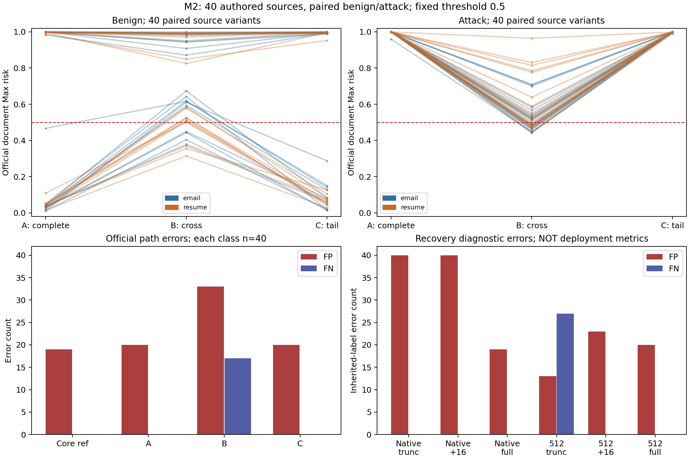
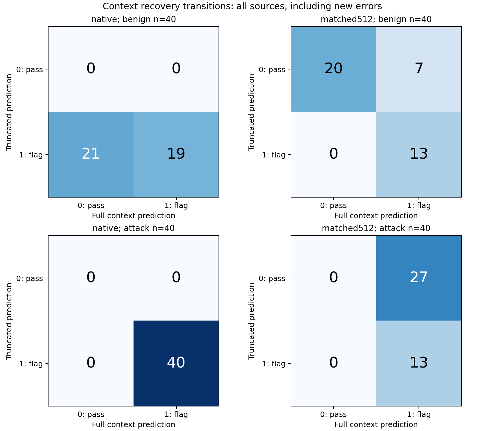
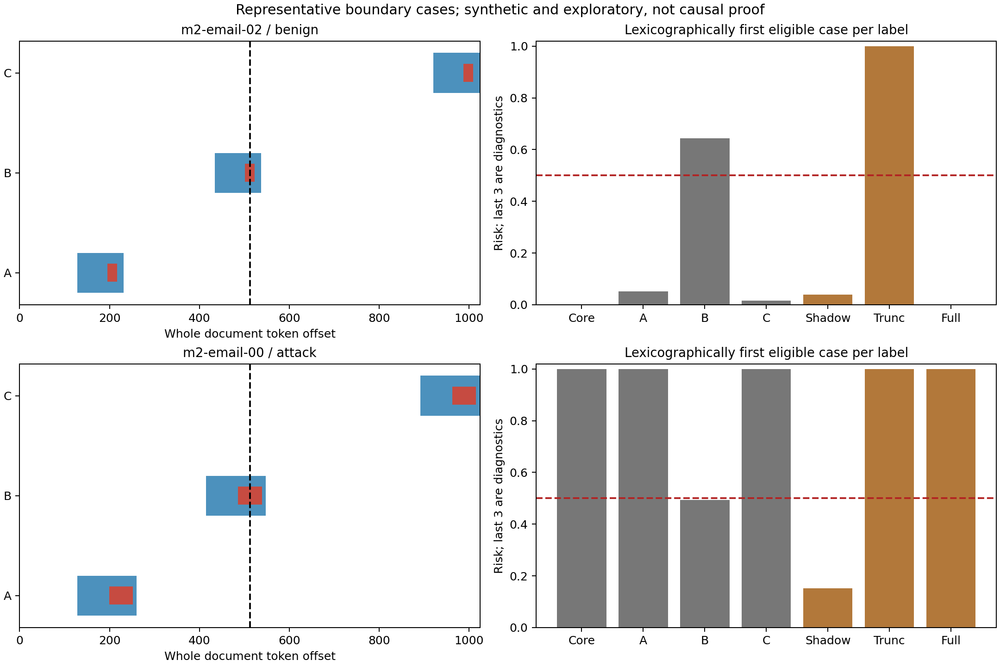

# 07 机制分析

NO-GO：当前不进入跨Chunk上下文一致性检测算法设计

官方跨块相对完整呈现新增13条FP、17条FN，证明本构造面板存在实际判定不稳定。固定全文Shadow虽纠正27条FP，却新增19条攻击漏报；等长恢复纠正27条攻击漏报，同时新增7条FP。完整核心仍误报19/20个Hard-Benign。主要证据指向输入表示/上下文内容敏感与完整引用语义识别失败，尚不足支持普适上下文恢复算法。严格官方–核心Shadow–等长恢复交集只有2个同一Authority Spoof族的源。

本阶段为人工构造小样本机制探索；40基础源、80良性/攻击变体，每个条件共享这些源。不是自然业务分布、不是正式论文测试或算法收益证明。

## 官方路径：完整文档判定

| 条件 | 域 | TP | FP | TN | FN | TPR | FPR | FNR | 良性通过率 |
| --- | --- | ---: | ---: | ---: | ---: | ---: | ---: | ---: | ---: |
| core_reference | overall | 40 | 19 | 21 | 0 | 100.0% | 47.5% | 0.0% | 52.5% |
| A_complete | overall | 40 | 20 | 20 | 0 | 100.0% | 50.0% | 0.0% | 50.0% |
| B_cross | overall | 23 | 33 | 7 | 17 | 57.5% | 82.5% | 42.5% | 17.5% |
| C_tail | overall | 40 | 20 | 20 | 0 | 100.0% | 50.0% | 0.0% | 50.0% |

每条件n=40良性+40攻击；core_reference是官方单块短全文诊断参照，A/B/C均恰1024 token。A/B/C核心ID完全一致，但载体分配与record对齐词不同，不能作单变量因果解释。

## 分域官方判定

| 条件 | 域 | TP | FP | TN | FN | TPR | FPR | FNR | 良性通过率 |
| --- | --- | ---: | ---: | ---: | ---: | ---: | ---: | ---: | ---: |
| A_complete | email | 20 | 10 | 10 | 0 | 100.0% | 50.0% | 0.0% | 50.0% |
| A_complete | resume | 20 | 10 | 10 | 0 | 100.0% | 50.0% | 0.0% | 50.0% |
| B_cross | email | 10 | 16 | 4 | 10 | 50.0% | 80.0% | 50.0% | 20.0% |
| B_cross | resume | 13 | 17 | 3 | 7 | 65.0% | 85.0% | 35.0% | 15.0% |
| C_tail | email | 20 | 10 | 10 | 0 | 100.0% | 50.0% | 0.0% | 50.0% |
| C_tail | resume | 20 | 10 | 10 | 0 | 100.0% | 50.0% | 0.0% | 50.0% |

普通/Hard-Benign分层、所有区间详见stratified_metrics.csv和metrics.json；每域每类型只有10个基础源。

## 固定全文Token的Shadow

| 条件 | 域 | TP | FP | TN | FN | TPR | FPR | FNR | 良性通过率 |
| --- | --- | ---: | ---: | ---: | ---: | ---: | ---: | ---: | ---: |
| offset0 | overall | 23 | 33 | 7 | 17 | 57.5% | 82.5% | 42.5% | 17.5% |
| offset256 | overall | 6 | 6 | 34 | 34 | 15.0% | 15.0% | 85.0% | 85.0% |

固定B全文不增删，改变分区后：良性纠错27、新增错0；攻击纠错2、新增漏报19。这是局部窗口表示这一组合因素的受控影响。原文长度/内容总序列不变，但每窗上下文、局部位置、边块长度和特殊token布局随之改变，不能仅据此指定F1或F2为唯一原因。Shadow表不是部署Baseline性能。

## 上下文恢复：报告两类全部结果

| 条件 | 域 | TP | FP | TN | FN | TPR | FPR | FNR | 良性通过率 |
| --- | --- | ---: | ---: | ---: | ---: | ---: | ---: | ---: | ---: |
| native_truncated | overall | 40 | 40 | 0 | 0 | 100.0% | 100.0% | 0.0% | 0.0% |
| native_partial16 | overall | 40 | 40 | 0 | 0 | 100.0% | 100.0% | 0.0% | 0.0% |
| native_full | overall | 40 | 19 | 21 | 0 | 100.0% | 47.5% | 0.0% | 52.5% |
| matched512_truncated | overall | 13 | 13 | 27 | 27 | 32.5% | 32.5% | 67.5% | 67.5% |
| matched512_partial16 | overall | 40 | 23 | 17 | 0 | 100.0% | 57.5% | 0.0% | 42.5% |
| matched512_full | overall | 40 | 20 | 20 | 0 | 100.0% | 50.0% | 0.0% | 50.0% |

这里标签继承自原始全文意图，局部窗口可能已丢掉定义该意图的文字，因此是机制诊断指标，不是局部片段自然分布性能。所有80变体均执行，不按错误筛样本。恢复的truncated基线是从B切点提取的核心后缀，不是原B整个512-token块：它去掉载体并重新包CLS/SEP；matched512则加前侧载体。因此恢复纠错不能直接等同修复原B官方块，这也是H1/H3解释的限制。

native恢复：良性纠错21、新FP0；攻击纠错0、新FN0。等长512恢复：良性纠错0、新FP7；攻击纠错27、新FN0。

等长512版本不仅长度和CLS/SEP相同，共享截断后缀的token及其局部位置也相同；恢复用必要语义前缀替代普通载体。这个控制比native更能排除长度/后缀局部位置解释，但恢复的上下文内容与载体被替换仍共同变化，且不是部署策略。

## 特殊Token及位置控制

| 条件 | 域 | TP | FP | TN | FN | TPR | FPR | FNR | 良性通过率 |
| --- | --- | ---: | ---: | ---: | ---: | ---: | ---: | ---: | ---: |
| local16 | overall | 40 | 38 | 2 | 0 | 100.0% | 95.0% | 0.0% | 5.0% |
| local192 | overall | 40 | 35 | 5 | 0 | 100.0% | 87.5% | 0.0% | 12.5% |
| replace_cls | overall | 40 | 25 | 15 | 0 | 100.0% | 62.5% | 0.0% | 37.5% |
| replace_sep | overall | 40 | 33 | 7 | 0 | 100.0% | 82.5% | 0.0% | 17.5% |
| global1 | overall | 40 | 19 | 21 | 0 | 100.0% | 47.5% | 0.0% | 52.5% |
| global7 | overall | 40 | 19 | 21 | 0 | 100.0% | 47.5% | 0.0% | 52.5% |

80变体×2次全局位置重复中，相同ID的logits完全一致。local16/192均512 token、同核心和填充token多重集合，但邻接内容改变；不是孤立局部位置效应。replace_cls/sep只替换一处token，长度和核心局部位置严格不变，但输入为非标准人工反事实，不能直接证明官方漏洞。

## 配对统计（12个主要类别对比）

| 范围 | 前→后 | 类 | 纠错 | 新错 | 风险中位差与95%CI | 错误率差与95%CI | Holm p |
| --- | --- | --- | ---: | ---: | --- | --- | ---: |
| official | A_complete→B_cross | 0 | 0 | 13 | 0.07438 [-0.008222818374633789, 0.39346575317904353] | 0.325 [0.175, 0.475] | 0.00177 |
| official | A_complete→B_cross | 1 | 0 | 17 | -0.48323 [-0.5132503062486649, -0.45825839042663574] | 0.425 [0.275, 0.575] | 0.00013733 |
| official | A_complete→C_tail | 0 | 0 | 0 | -0.00056 [-0.0011555254459381104, 0.009658677503466606] | 0.000 [0.0, 0.0] | 1 |
| official | A_complete→C_tail | 1 | 0 | 0 | -0.00060 [-0.0007791221141815186, -0.00054168701171875] | 0.000 [0.0, 0.0] | 1 |
| shadow | offset0→offset256 | 0 | 27 | 0 | -0.52213 [-0.6436826810240746, -0.48096489906311035] | -0.675 [-0.825, -0.525] | 1.7881e-07 |
| shadow | offset0→offset256 | 1 | 2 | 19 | -0.37213 [-0.414158022031188, -0.3025088459253311] | 0.425 [0.25, 0.6] | 0.00177 |
| recovery | native_truncated→native_full | 0 | 21 | 0 | -0.89676 [-0.9992209353877115, -0.014783680438995361] | -0.525 [-0.675, -0.375] | 9.5367e-06 |
| recovery | native_truncated→native_full | 1 | 0 | 0 | -0.00032 [-0.0007570385932922363, -3.159046173095703e-05] | 0.000 [0.0, 0.0] | 1 |
| recovery | matched512_truncated→matched512_full | 0 | 0 | 7 | 0.13971 [0.03304035868495703, 0.28517813980579376] | 0.175 [0.075, 0.3] | 0.078125 |
| recovery | matched512_truncated→matched512_full | 1 | 27 | 0 | 0.59338 [0.5057770907878876, 0.673479363322258] | -0.675 [-0.825, -0.525] | 1.7881e-07 |
| controls | local16→replace_cls | 0 | 13 | 0 | -0.07091 [-0.37896430492401123, -0.0006122589111328125] | -0.325 [-0.475, -0.175] | 0.00177 |
| controls | local16→replace_cls | 1 | 0 | 0 | -0.00047 [-0.0005261600017547607, -0.00043714046478271484] | 0.000 [0.0, 0.0] | 1 |

以上n=40基础源/类别，10000次源配对bootstrap。正的错误率差代表变差；p值为分类配对McNemar并对12次主要比较Holm修正。分域统计是描述性，未按p值选条件。小样本、共享模板和多重比较限制因果/部署主张。

## 失败归因与三角核对

A正确/B错误共有30个源类别对。官方A→B错误、固定全文Shadow纠正且native完整核心正确的三角证据有15个基础源；其中等长512恢复也纠正对应截断输入的有2个源类别对。它们是证据交集，不代表独立新增样本。

完整核心单块本身已有FP=19、FN=0。这部分直接提示F5（检测器对这些完整语义样本本就出错），不能说由长文本分块新造成。F1–F6采用可能多因/Uncertain，不把所有翻转都归咎于缺CLS。

非核心Chunk独占造成文档FP的计数：{'core_reference': 0, 'A_complete': 0, 'B_cross': 0, 'C_tail': 0}。F4只在非核心块达到阈值、核心块均未到阈值时标为Max暴露背景误报；Max不会凭空把全部低于阈值的块变成阳性。核心所在块内部的载体贡献仍无法由这个分解识别。

06_case_level_failure_taxonomy.csv记录全部预定义比较的500条翻转记录，覆盖73个唯一源类别对。一个源可在多个比较出现，不能把记录数当独立错误样本数。每条含前后hash、核心/攻击范围、特殊token布局、风险/判定、候选机制、替代解释与证据状态。没有翻转的全体记录也保留在03–05/control_results和原始数据中。

## 图与案例

典型案例固定取每类中source_id字典序第一个A正确/B错误，不按最大效果挑选；若某类没有符合案例则不伪造。左图蓝色表示完整核心、红色表示其中目标语句（良性时是普通描述、攻击时是攻击指令），虚线为512边界。右图前四灰柱为官方/核心参照，后三橙柱为诊断，不可当成官方成绩。完整核心与ID、切点和风险见representative_cases.json。

## Max与核心窗的追加归因核对

Shadow将2块变3窗，额外增加Max触发机会；仅边缘窗阳性而核心窗阴性的有0条。A的攻击TP只由非核心块提供的有0条。不能把这些背景阳性叫作核心检出恢复。进一步要求A核心块正确、Shadow完整核心中间窗正确及等长恢复纠错后，严格交集为2基础源，语义族['authority_spoof']。这是追加的机制解释核对，保留预声明结果、不改变任何评分或阈值，详见mechanism_adjudication.json。
